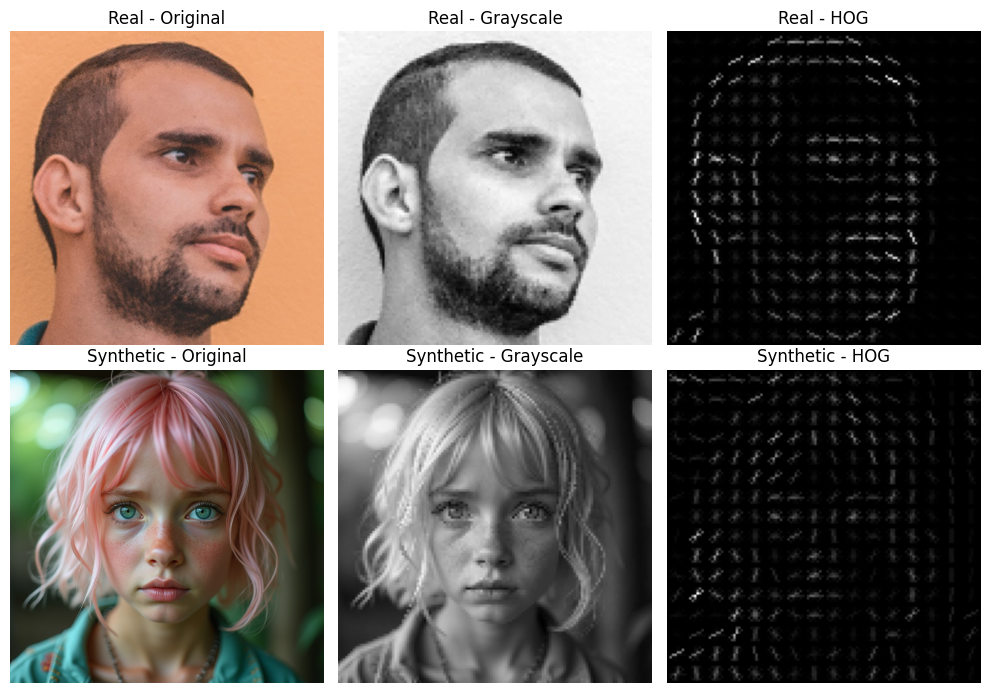
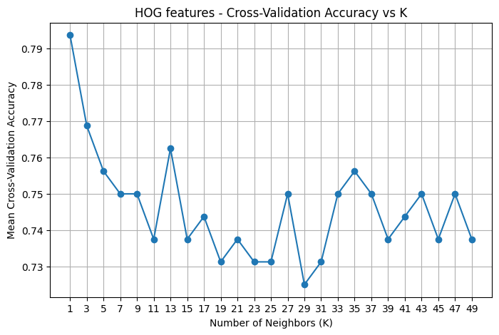
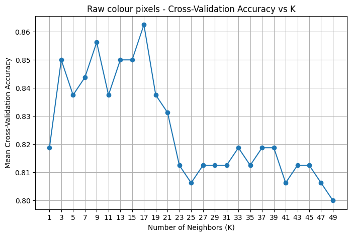
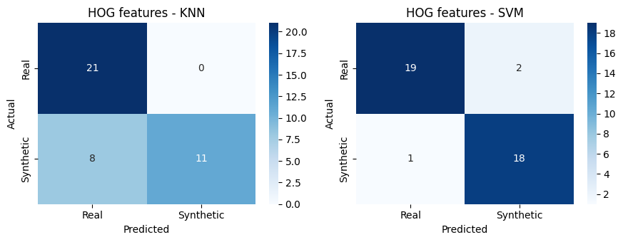
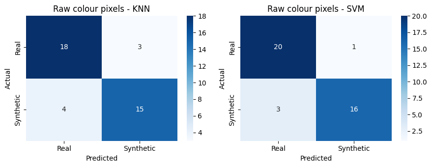

# Real vs Synthetic Face Classification

A classical machine-learning image classification project that compares **HOG features** and **raw colour pixels** with **K-Nearest Neighbours (KNN)** and a **linear Support Vector Machine (SVM)** to distinguish real face images from synthetic face images.

The project focuses on a simple question: **does the choice of image representation change which ML model performs best?**



## Project overview

The original coursework dataset contained **200 balanced training images**, with 100 real faces and 100 synthetic faces. Every image was resized to 128 x 128 pixels. Two feature representations were compared:

- **HOG:** grayscale edge, contour and texture information
- **Raw colour pixels:** flattened RGB/BGR pixel values that preserve colour information

Two classifiers were then evaluated on each representation:

- K-Nearest Neighbours (KNN)
- Linear Support Vector Machine (SVM)

KNN's `k` value was selected with cross-validation. The models were evaluated using a held-out test split, confusion matrices, five-fold cross-validation, and a separate set of 10 unseen images.

## Results

### Held-out test set

| Feature representation | KNN | SVM |
|---|---:|---:|
| HOG | 80.0% | **92.5%** |
| Raw colour pixels | 82.5% | 90.0% |

**HOG + SVM** produced the strongest held-out test accuracy at **92.5%**.

### Five-fold cross-validation

| Model | Mean accuracy | Std. dev. |
|---|---:|---:|
| HOG-KNN | 77.5% | 4.18% |
| **HOG-SVM** | **93.5%** | 3.74% |
| Raw-KNN | 84.5% | **3.32%** |
| Raw-SVM | 88.5% | 3.39% |

HOG-SVM had the highest mean cross-validation accuracy, while Raw-KNN had the lowest variation across folds.

### External-image check

The four models were also tested on **10 images that were not part of the original dataset**.

| Model | Correct | Accuracy |
|---|---:|---:|
| HOG-KNN | 4 / 10 | 40% |
| HOG-SVM | 7 / 10 | 70% |
| **Raw-KNN** | **8 / 10** | **80%** |
| Raw-SVM | 7 / 10 | 70% |


The external set is intentionally described as a **small generalisation check**, not a reliable estimate of real-world performance. Ten images are far too few to make a broad performance claim.

For privacy, the public portfolio version reports **aggregate accuracy only**. The individual external test images, filenames, and per-image predictions are not included.

## What I learned

The strongest model on the original test split was not the strongest model on the small external set. HOG-SVM performed best on the held-out dataset, while Raw-KNN correctly classified the most external images.

This highlighted three useful ML lessons:

1. **Feature representation matters.** HOG helped SVM more than KNN, while raw colour information helped KNN on this dataset.
2. **High test accuracy does not guarantee strong generalisation.** The results dropped when image style changed.
3. **External evaluation matters.** Aggregate accuracy on unseen images showed a clear generalisation gap compared with the original held-out test set.

## Visual results

### KNN tuning

| HOG features | Raw colour pixels |
|---|---|
|  |  |

### Confusion matrices

| HOG features | Raw colour pixels |
|---|---|
|  |  |

## Repository structure

```text
real-vs-synthetic-face-classification/
├── README.md
├── requirements.txt
├── .gitignore
├── assets/
│   ├── feature_examples.png
│   ├── hog_knn_cv.png
│   ├── hog_confusion_matrices.png
│   ├── raw_knn_cv.png
│   └── raw_confusion_matrices.png
├── data/
│   └── README.md
├── notebooks/
│   └── real_vs_synthetic_face_classification.ipynb
├── src/
│   └── face_classification.py
└── report/
    └── project_report.pdf
```

## Run locally

1. Clone the repository.
2. Create a Python environment.
3. Install the dependencies:

```bash
pip install -r requirements.txt
```

4. Add your permitted images using the folder structure in [`data/README.md`](data/README.md).
5. Run the notebook, or run the script from the repository root:

```bash
python src/face_classification.py
```

The cleaned code uses local relative paths instead of Google Drive-specific paths.

## Limitations

This is a **student classical-ML project**, not a production deepfake detector. Important limitations include:

- only 200 images in the original labelled dataset
- only 10 external test images
- backgrounds, lighting, clothing and accessories may influence raw-pixel predictions
- synthetic-image generators can produce styles not represented in the training set
- no face detection or alignment is applied before feature extraction
- no deep-learning baseline is included

## Possible improvements

Future work could include a larger and more varied dataset, face detection and alignment, image augmentation, colour histograms combined with HOG, broader hyperparameter tuning, and a substantially larger external test set.

## Portfolio note

This repository is a cleaned portfolio version of an academic project. Personal identifiers and private dataset links have been removed from the public-facing files. The result tables above preserve the original recorded project results. The cleaned code also makes the data paths portable and uses a stratified train/test split for reproducibility on balanced classes, so a fresh run can produce slightly different values from the original submitted notebook.
